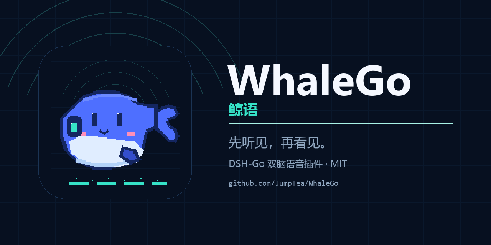

# WhaleGo · 鲸语

> 先听见，再见。

DSH-Go 的双脑语音插件。语音脑先开口，文字脑只把复杂问题写清楚；两条输出都写进同一个会话窗、同一个消息列表，并持久化可回看：语音一条在上、文字一条在下，各自可复制；不是字幕、弹幕或悬浮窗。



## 宣传片

[](assets/promo/whalego-promo-48s.mp4)

- [1080p · 48s · 60fps](assets/promo/whalego-promo-48s.mp4)

## 名字

鲸鱼靠声呐辨认方向，靠鲸歌交换消息。听与说，本来就是鲸鱼的事。

`whale` 也是 DeepSeek 的意象，`Go` 指 DSH-Go。中文名「鲸语」取鲸歌与语言的双关：声音先到，文字随后。

## 它解决什么

普通语音助手只有一条通道：要么全说，要么全写。遇到「查一下、整理成文件」这种一句话说不清的请求，说的版本太浅，写的版本又来得太慢。

WhaleGo 把回答拆成按需启动的两条通道，两条都在**同一个 DSH 会话**里：

1. **语音脑**先开口。它拿到问题后立刻给出一句自然的过渡（可设为「我想想。」），然后**边说边生成**：文字增量流进会话里的语音消息，音频按句流式播放，首句不等整段生成完。
2. **文字脑只在复杂问题启动**。它和语音脑共享同一个会话、同一份上下文、同一套工具与环境，独立生成完整答案，并**流式**写在语音消息下方；两条流互不截断。
3. 简单问题只走语音脑：**用户的原问题仍然进入 DSH 会话**（作为用户消息），但不启动文字脑，也不产生文字答案；语音消息就是本轮的回答。
4. 语音消息继续增长时，会把文字脑的答案往下推。两条消息都在会话消息列表里，同一层，都持久化、都能往回翻，不是字幕、弹幕或悬浮窗。

> 当前 DSH-Go v1.2 还缺四项核心桥：持久化的会话内语音消息、流式音频、同会话语音回合（含「只落用户消息、不跑文字模型」），以及说话时的实时转写。悬浮球是控制入口、设置走插件页，不阻塞核心体验。`lib/nativeSeam.js` 已为 voiceLine / audioStream 留好探测；`voiceTurn` / `voiceInput` 的接缝与引擎切换待接。
> 
> 插件侧已接上 `audioStream`：`SpeechService.synthesizeStream()` 把 Edge 的每个音频块直接写进 `ctx.dshGo.audioStream()`，宿主没有该能力时回退到 v1.2 的 `media` 整段播放，行为不变。
>
> 宿主带附件存储时，语音消息会先把整段 mp3 记成附件，再带 `audio.attachmentId` 落库（`saveVoiceAudio`），这样刷新/重进后仍能重放同一段音频；App 播放器还没接，当前只渲染转写文本。

## 交互原则

- **同一会话、同一列表、同一层。** 语音消息是消息列表里的一条持久记录，排在当前轮文字答案上方；不叠加字幕条，不飘弹幕，不开第二条悬浮窗。
- **悬浮球是控制入口，不是输出面。** 插件只声明样式、大小、待机和状态；像素、动画、位置都由 Flutter 绘制。语音文字永远不画在球上。
- **设置不在球下面。** 所有开关都在插件页的「鲸语设置」里，点开即用。
- **打断即停。** 停止按钮会同时停掉语音、音频流、取消文字脑的回合，并保留已经说出的内容。
- **不伪造回合。** 用户的原问题由宿主正常写入会话；语音行保存在插件自己的注册表（`$DSH_HOME/whalego/voices.json`），由 Web UI 的悬浮球渲染与回放，绝不向会话日志写假的 `assistant/message`。

## 功能

- 双脑按需：语音脑流式说 / 写；复杂问题才启动文字脑，简单问题只走语音。
- 全流式：语音消息文字增量更新，音频按句边合成边播；说话时实时转写，文字脑的答案也走 DSH 原生流。
- 同会话同上下文：语音脑和文字脑共享同一个 DSH 会话、同一份历史和工具；不是两个独立机器人。
- 可回看：语音消息与文字答案都是会话里的持久记录，刷新、重进、往回翻都在，可分别复制。
- 简单问题：用户原问题进会话，只产生语音消息，不产生文字答案。
- 四种面板：鲸语实录、鲸语设置、关于鲸语、接缝诊断。
- 六个入口：发送区「鲸语」「停」，消息区「朗读」「鲸语解释」，状态条「鲸语 · 待命」，以及设置页。
- 自定义悬浮球：像素鲸、声呐、极简、关闭；小 / 中 / 大；游动 / 呼吸 / 静止。
- 声音：晓晓、云希、晓伊；慢 / 正常 / 快；思考前填词三档。
- 语音缓存、保留轮数、自动播放、语音文字流显隐。
- Edge TTS，无需密钥；失败时回退到一句短提示，不阻塞文字答案。

## 安装

WhaleGo 是 DSH-Go 宿主插件。插件目录放在 DSH-Go 的插件根下：

```bash
git clone https://github.com/JumpTea/WhaleGo.git "$DSH_HOME/dsh-go/plugins/local-whalego"
```

然后在 DSH-Go 里重载插件（或重启宿主）。插件通过 `package.json` 的 `dshGo` 清单声明自己，App 只读取声明与 JSON 视图，不执行插件代码。

### Web UI 版（不改 App，装到官方版本也能用）

```bash
dsh plugin --profile <profile> add /path/to/WhaleGo
dsh <profile> --port 3100 --host 127.0.0.1 --no-open
```

打开页面后，输入框那一排会多出一个 **32px 麦克风原生按钮**（和发送、附件同一层），点一次从底部滑出语音页；没有 slots 的老版本会退回右下角的悬浮球。

- 语音页是**浅色全屏**（`#f7f7f5`），中央一颗会缓慢漂移的天蓝→白云朵球（`clamp(168px,54vw,300px)`），顶部只有 38px 的 ☰ 收起；页面**只覆盖到输入框上方**，DSH 原生输入条始终露在底部、始终可用。
- 打开后自动聆听（Web Speech 实时转写），静音 1.4 秒自动发；点球会缩成 **27vw** 小球、落到输入条上方，把原生聊天和文字流露出来（说话中也是这样收起，不打断）；再点小球回全屏，若正在说话会先打断再开始下一轮聆听。全屏说话/思考时点页面空白才会打断。
- 也可以直接在原生输入框里打字发送：应用自己处理这条消息，插件把 agent 的回答**镜像**进语音页并朗读（Markdown 剥成口语），同时自动缩成小球，让你看着聊天里的文字流。
- 回答一边生成一边出现（SSE `live` 的 `speech[]` 按句下发），音频由 `/whalego/speak` 流式返回，MediaSource 首块即起播；当前句播放时预取下一句，句间空档约 10–20ms。
- 语音回合走**真实 DSH 会话**（`TextBrain.prompt`），所以用户问题和答案都会留在原生聊天里，刷新、重进、往回翻都在。
- ☰ 收起语音页，右下角留 64px 迷你球（位于输入条上方），仍可直接语音问答；点迷你球回到全屏并开始聆听；点原生 ✕ 才结束语音模式。
- 进出场只动 `transform`/`opacity`（460ms，`cubic-bezier(.22,1,.36,1)`），并用 WebAudio 双音做开合提示音。
- 自动选择最近一个**活着的**会话；没有就新开一个空会话，不会把话发给已断开的旧会话。
- 完整的视觉/交互规格与验收记录见 [`docs/专题-Web语音空间设计.md`](docs/专题-Web语音空间设计.md)。

### 冒烟测试（真 key）

```bash
# 纯 web 半侧：真实答案、文字流、多轮、流中取消、音频流
node tools/smoke-web.mjs http://127.0.0.1:3100 <token>

# agent 半侧：真实工具写文件 + shell 统计
node tools/smoke-agent.mjs node_modules/@deepseek-ai/dsh/lib/bin.js <profile> D:\dsh-go-lab
```

要求：

- DSH-Go 宿主 `>= 0.2.1-rc.2 < 0.3.0-0`
- Node.js `>= 24`
- 可访问 Edge TTS 的网络（只发文本，不发音频）

## 设置

打开「鲸语设置」面板。所有项都只写偏好，不改原生绘制：

| 分组 | 选项 |
| --- | --- |
| 双脑模式 | 自动 / 总是双脑 / 朗读答案 |
| 声音 | 晓晓 · 女声 / 云希 · 男声 / 晓伊 · 女声 |
| 语速 | 慢 / 正常 / 快 |
| 思考前 | 我想想。 / 嗯，我看看。 / 不说 |
| 悬浮球样式 | 像素鲸 / 声呐 / 极简 / 关闭 |
| 悬浮球大小 | 小 / 中 / 大 |
| 待机动作 | 游动 / 呼吸 / 静止 |
| 语音文字流 | 显示 / 隐藏 |
| 语音缓存 | 开 / 关 |
| 保留轮数 | 4 / 6 / 10 |
| 自动播放 | 开 / 关 |

偏好保存在 `$DSH_HOME/whalego/prefs.json`。实录保存在 `$DSH_HOME/whalego/transcript.json`，只保留最近几轮，可一键清空。

## 架构

```text
DSH-Go (Flutter)
   │  dshGo 清单 + JSON 视图 + audio 效果
   ▼
WhaleGo host plugin (Node 24)
   ├─ lib/index.js        挂载、事件、面板 / 按钮 / 路由
   ├─ lib/panels.js       4 个声明式面板 + 设置写回
   ├─ lib/actions.js      按钮 → 效果；media / capability
   ├─ lib/engine.js       双脑编排、状态机、快照
   ├─ lib/voiceBrain.js   语音脑：短句 + 流式转写
   ├─ lib/textBrain.js    文字脑：DSH 会话回合
   ├─ lib/transcript.js   会话内语音行 + 文字答案
   ├─ lib/tts/            Edge TTS + 缓存
   └─ lib/nativeSeam.js   原生接缝特性探测与空实现
```

数据流：

```text
用户点「鲸语」
  → engine.ask()：把用户原问题写入 DSH 会话
  → 判断复杂度：简单 → voice-only；复杂 → dual
  → voiceBrain：在同一会话上下文里生成过渡句与短回答（流式）
       → 文字增量 → voiceLine（会话列表里的语音行）
       → 句子边界 → TTS 分句合成 → audioStream 边合成边播
  → 仅 dual 才启动 textBrain：同一会话里独立生成完整答案（DSH 原生流）
  → transcript：语音行在上，文字答案在下；都在同一消息列表
```

文字脑不是把语音转写再总结一遍。它和语音脑拿到的是同一个问题，独立生成；语音脑的转写只负责「说」，文字脑的答案负责「写」。

## 原生接缝

当前 DSH-Go v1.2 的插件契约提供：

- `audio` / `voice` / `micro` / `overlay` 四项能力
- `media`、`micro`、`overlays` 各两个声明位
- `audio` 播放、`voice` 起停、`overlay` 显隐
- 16 个声明式视图组件

还缺四项核心桥：

- `voiceLine`：会话内持久化的语音消息，刷新 / 重进都在，不是临时行、字幕 / 弹幕 / 浮窗。
- `audioStream`：首句先播，后续边合成边播。
- `voiceTurn`：同一会话里的语音回合——用户原问题落库、语音脑共享上下文；`dual` 由宿主带文字脑，产出两条独立消息。
- `voiceInput`：说话时实时转写，partial 以草稿用户消息进会话，定稿后提交。

外围还有 `voice`（免手 ASR、VAD、barge-in）与 `orb`（原生悬浮球，仅控制入口）；插件设置已有 DSH 的 settings schema 可走，不算原生缺口。`lib/nativeSeam.js` 目前探测 voiceLine / audioStream / voice / orb / settings 五个；`voiceTurn` 与 `voiceInput` 的接缝尚未接上。

完整的字段、事件与验收标准见 [docs/native-gaps.md](docs/native-gaps.md)。

## 开发

```bash
cd WhaleGo
node --test
node --check lib/index.js
```

本地契约检查（需要 DSH-Go 的 `kit-lib-check`）：

```bash
node check.mjs . --lang zh
```

品牌图重新生成：

```bash
python tools/brand/make-brand.py
```

## 隐私

- 不上传麦克风音频；免手语音识别由 DSH-Go 原生侧完成（待 `native.voice`）。
- TTS 只把要朗读的文本发给 Edge TTS。
- 不提供实录的 HTTP 路由；实录只存在本机 `$DSH_HOME/whalego/transcript.json`。

## 许可证

MIT。见 [LICENSE](LICENSE)。

「鲸语」「WhaleGo」、像素鲸形象与相关标识是项目品牌资产；MIT 不授予商标使用权。详见 [NOTICE](NOTICE)。

## 链接

- 仓库：<https://github.com/JumpTea/WhaleGo>
- 问题：<https://github.com/JumpTea/WhaleGo/issues>
- 原生接缝：[docs/native-gaps.md](docs/native-gaps.md)
- 工程交接：[docs/handover.md](docs/handover.md)
